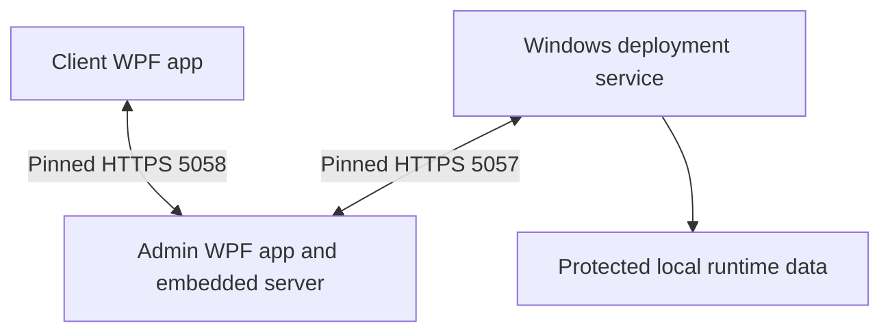

# AutoShutdown Nova

Windows Admin–Client management software for inactivity shutdown, remote PC controls and approved software deployment.

**Source recovery edition.** The Admin and Shared sources include the saved Step 4 and scrolling updates. The Client was recovered from a later saved snapshot and adapted back to the Step 4 protocol. This folder is not claimed to be the exact source used for the previously installed MSI. See [Recovery and validation](docs/RECOVERY.md) before building or deploying it.

## Features

- WPF Admin dashboard and registered Client PC status.
- Separate visibility for the control app and deployment service.
- Super Admin setup, administrator permissions, device scope and expiring sessions.
- Pinned HTTPS pairing with a separate identity for each Client.
- Approved EXE/MSI deployment, per-PC batch results, installation verification and retries for confirmed failures.
- Messages, image delivery, groups, schedules and activity records.
- Inactivity monitoring, idle display, pause/resume and shutdown controls.
- MSI authoring and Windows build scripts.

The source includes later Admin improvements; it excludes unfinished per-PC signed policy acknowledgement and enforced Client lockdown work.

## Architecture



The control app runs in a signed-in user session. The deployment service runs as LocalSystem. Admin must remain open for live commands and new installation transfers. Separate Admin installations do not automatically share accounts, Client identities or history. Cross-network management needs a reachable, approved network path; this edition has no cloud relay.

## Source layout

| Folder | Contents |
|---|---|
| `src/AutoShutdown.Admin` | Admin UI, authentication, embedded endpoints and deployment store |
| `src/AutoShutdown.Client` | Recovered Client UI, pinned control connection and inactivity handling |
| `src/AutoShutdown.DeploymentService` | Background Windows installer service |
| `src/AutoShutdown.Shared` | Protocol, transport, validation and shared models |
| `tests` | Console-based security and installation batch checks |
| `tools/msi` | Saved Admin and Client MSI build kit and its payload |
| `scripts` | Windows validation and deployment support scripts |
| `docs` | Pairing, troubleshooting and recovery notes |

## Build on Windows

Install the .NET 10 SDK on a Windows 64-bit development PC. From the extracted repository root, run:

```powershell
powershell.exe -NoProfile -ExecutionPolicy Bypass -File .\scripts\Verify-RecoveredSource.ps1
```

This parses PowerShell scripts, builds all solution projects and runs the two check programs with temporary data. It does not install a service, deploy software to a Client or execute shutdown commands. Check the output; no successful Windows build is claimed for this recovery edition yet. The included GitHub Actions workflow runs the same checks on Windows after upload.

After validation, launch Admin from a normal Windows user session:

```powershell
dotnet run --project .\src\AutoShutdown.Admin\AutoShutdown.Admin.csproj -c Release --no-build
```

There is no default administrator password. Create the first Super Admin and privately retain its recovery code. The tracked appsettings.example.json files contain blank credentials and are copied to build output as appsettings.json. Register each Client using a separate exported connection; do not commit the resulting files.

## Connect Clients

See [UI setup and troubleshooting](docs/USER_GUIDE.md). Save the Admin LAN IPv4 in Settings, reopen Admin, export a file for the exact Client device name, and import it through the installed Client connection wizard. Both the installer service and control app must be verified separately.

## Build MSI packages

Only after a successful Windows validation, run:

```powershell
powershell.exe -NoProfile -ExecutionPolicy Bypass `
  -File .\tools\msi\Build-BothMSI.ps1 -ProjectRoot (Get-Location).Path
```

The saved kit builds self-contained x64 packages using WiX 5.0.2. It checks application tests and MSI metadata before producing output. Those checks do not prove installation, upgrade, reboot or network pairing. Treat newly built installers as test candidates. Never replace an installed production package with this recovery source without the missing runtime checks.

## Validation status

The previous Windows project passed 55 batch checks and 62 security checks, and its two MSIs were built on 15 October 2026. Those historical results are not results for this recovered source. No 100+ Client load test is claimed. See [Recovery and validation](docs/RECOVERY.md) for the exact recovery work and pending checks.

## Repository hygiene

Build output, installers, private certificates, pairing files and machine records are excluded. Do not add runtime credentials or office data. Put verified distributable binaries in a separate release only when appropriate; no binaries are included here. Report potential security issues privately rather than posting credentials in an issue.

This is an internship project source recovery, not an official product release. No redistribution license is granted by this repository; a license has not been selected.
